# Why this problem, and where its trees live

- **Date:** 2026-11-14 (Saturday); second version, about 11:40 PT, after two background checks reported.
- **Author:** Claude Fable 5.2 (AI, orchestrator), at the team's request for motivation, physical connections and pictures. Sections 2, 6 (triangles and squares), 7 (Feynman diagrams), 8 and part of 12 come from an independent hunt by a Claude subagent that was given only the statement of our results (`notes/2026-11-14_new_connections_blind.md`); I re-ran its checks and drew the pictures.
- **Status:** every statement marked **exact** is a consequence of the main proof (approved by the professor on 2026-11-14; his name is still to be entered in `CLAIMS.md`) or is checked by computer in `experiments/E011_crossfield_checks`, `E012_connections` and `E013_new_connections_blind`. Statements marked **analogy** are ways of speaking. What other fields call things, and who introduced them, rests on two source checks by Claude subagents: `notes/2026-11-14_crossfield_literature.md` and `notes/2026-11-14_motivation_sources.md`; the bibliographic data are in `references/README.md`, cited here as [n]. Not human-verified.
- **Pictures:** all figures are produced by `talk/figures/make_figures.py` (PDF for the slides, PNG here). Blue circle = symmetric node, orange square = asymmetric node, green = a complete tree.

---

## 1. The pattern

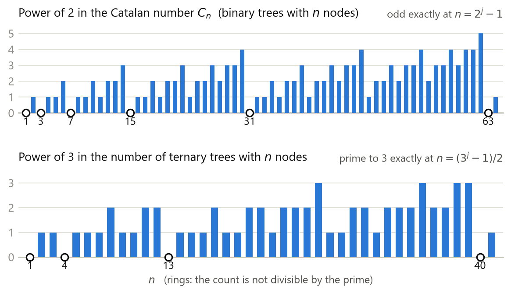

The Catalan number C_n counts binary trees with n nodes. It is odd exactly when n + 1 is a power of 2, and in general the power of 2 in it is (number of ones in the binary expansion of n + 1) − 1. In a computer that is one instruction: popcount(n + 1) − 1. The same happens for every prime p and trees with p branches: the power of p is (digit sum of the number of leaves − 1)/(p − 1).

This has been known for a long time, by a computation with factorials. The computation gives the answer and no reason. **The question of Problem 137 is the reason: why should the digits of a number have anything to do with trees?**

## 2. A shape of tree is a mobile

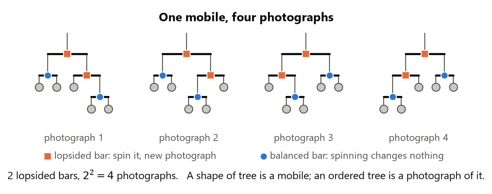

Hang a tree from the ceiling as a mobile: every bar can spin about its string. A drawing of the tree on paper is then a photograph of the mobile, and the same mobile has several photographs.

**Exact.** A mobile with d lopsided bars has exactly 2^d photographs (for p arms per hub: p^d). Spinning a balanced bar, one whose arms carry the same sub-mobile, changes nothing.

Two remarks. For p ≥ 3 a hub can turn but cannot be mirrored, which is why our classes use rotations and not reflections. And "mobile" is the established name: the OEIS lists the numbers of our classes as "k-ary mobiles (circular rooted trees)" (A398107; for k = 2, 3, 5 its columns are A001190, A000625, A036727) [25].

So the count of ordered trees, the Fuss–Catalan number, is a sum of powers of p, one for each mobile. Its power of p is the smallest power that occurs, provided the number of mobiles with that smallest power is not divisible by p. **That is the whole plan of the proof.**

## 3. One tree, four sciences

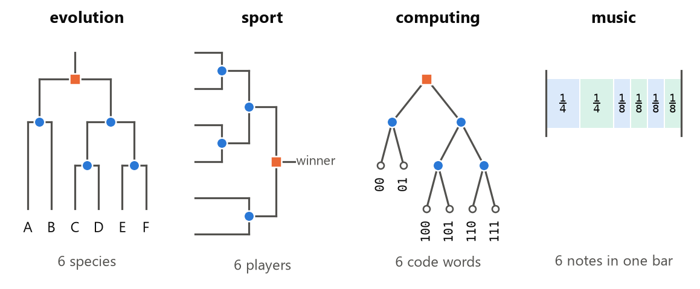

The same tree with 6 leaves, as an evolutionary tree, a knockout tournament, a prefix code and a bar of music. In each of these the left-to-right order of the branches is an accident of the drawing. Each field really works with mobiles, and the question "how many photographs?" has the same answer everywhere.

**Exact.** 6 = 110 in binary has two ones, so every tree with 6 leaves has at least 2 − 1 = 1 lopsided node; the tree shown has exactly one.

Scientists count lopsided nodes for their own reasons. Biologists measure the balance of an evolutionary tree by its "symmetry nodes" (Kersting and Fischer 2021 [4]; a 2023 book surveys such balance indices [32]). Neuroscientists measure the asymmetry of branching nerve cells (van Pelt and others 1992 [31]). The airways of the lung are modelled as about 23 generations of regular two-way branching (source file, item 13).

## 4. What the theorem says: the best possible symmetry

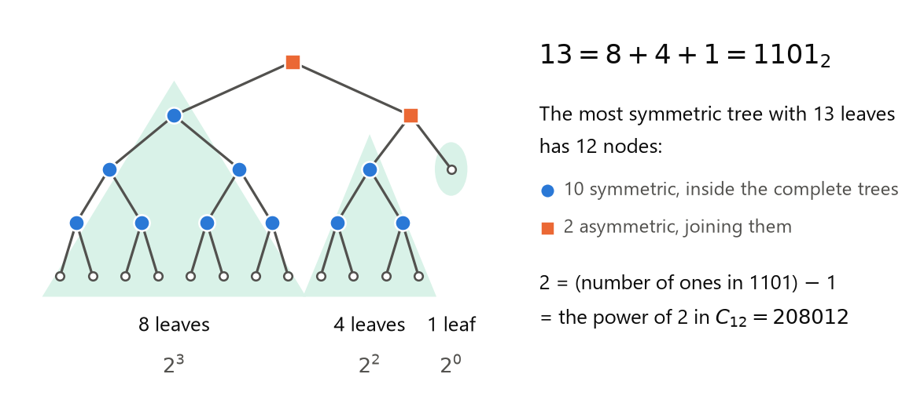

**Exact.** A tree with m leaves has (m − 1)/(p − 1) nodes. At least t of them are asymmetric, t = (digit sum of m − 1)/(p − 1), and the trees with exactly t are these: write m in base p; take one complete tree for every unit of every digit; join them by t asymmetric nodes. The digits of m are not a formula in this proof. **They are the building blocks of the most symmetric tree.**

Equivalently (**exact**): the symmetries of a tree form a group of order p^(number of symmetric nodes), and

    power of p in the number of trees = (number of nodes) − log_p(order of the largest symmetry group).

The trees that reach it are exactly those whose symmetry group is as large as a group of p-power order acting on m leaves can be (a Sylow p-subgroup of the symmetric group on the leaves).

## 5. Chemistry: butyl groups and branched polymers

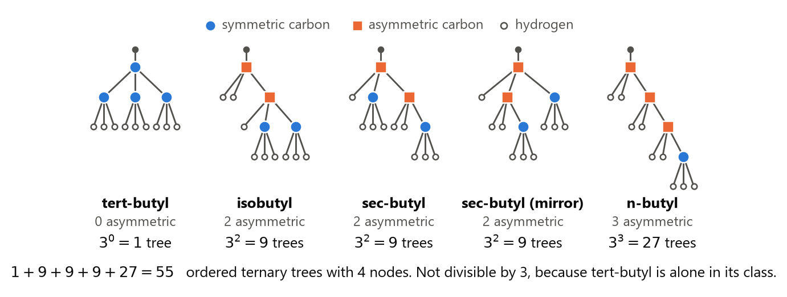

The three further bonds of a carbon atom can be rotated but not reflected. So an alkyl group is a ternary mobile, and our classes for p = 3 are the alkyl groups with mirror images counted separately (OEIS A000625: 1, 1, 2, 5, 11, 28, 74, …). Counting such molecules is where the mathematics of trees met chemistry: Cayley counted the alkanes as trees in 1874–75, and Pólya's 1937 paper has chemical compounds in its title (source file, item 1).

**Exact (E012, part A).** For four carbons there are five: tert-butyl, isobutyl, sec-butyl in its two mirror-image forms, and n-butyl. Over them stand 1, 9, 9, 9 and 27 ordered ternary trees: 55 in all. The number 55 is not divisible by 3 **because tert-butyl is alone in its class**: it is perfectly branched, and all 81 = 3^4 rotations of its four carbons leave it unchanged. If reflections are allowed as well, the two sec-butyls merge and four groups remain, the four butyl groups of the textbooks (OEIS A000598; [30]).

*On names.* The four groups are in a current textbook [30]. IUPAC now prefers "butan-2-yl" and "2-methylpropyl" to "sec-butyl" and "isobutyl". That the sec-butyl group has two mirror-image forms we found stated only on Wikipedia; it agrees with the two OEIS counts (5 against 4).

**Exact.** The number of ternary trees with n nodes is prime to 3 exactly when n = 1, 4, 13, 40, …, the sizes at which a perfectly branched group exists (methyl, tert-butyl, …).

**Analogy with a real counterpart.** Chemists call the order of such a group the symmetry number σ. It lowers the entropy of a molecule by R·ln σ, and a freely rotating methyl group contributes a factor 3 [11].

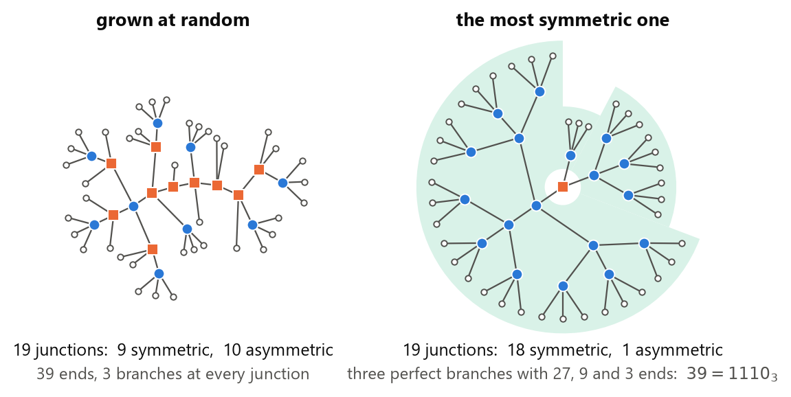

Two tree-like molecules with 39 ends and three branches at every junction. Left: grown at random, 10 of its 19 junctions are asymmetric. Right: the most symmetric one possible, a single asymmetric junction carrying three perfect branches of 27, 9 and 3 ends, because 39 = 1110 in base 3. Chemists make both kinds: hyperbranched polymers grow at random; dendrimers are built generation by generation from a core, and their perfect branches are called dendrons [29]. Our "atoms" are dendrons.

**Exact (E012, part L; brute force over all labelled trees for small sizes).** In the classical theory of branched polymers, the number of ways to form a tree-like molecule from n units with f reactive groups each is governed by "Stockmayer's combinatorial factor" ω_n = (fn − n)!/(n!·(fn − 2n + 2)!) (as given in a 2022 paper [19], citing Stockmayer 1943 [18]; the statistical weight of an n-mer there is f^n·ω_n). By arithmetic,

    ω_n = (Fuss–Catalan number for q = f − 1 and n) / (number of unreacted groups, (f − 2)n + 2).

So the Fuss–Catalan numbers of our theorem are, up to that divisor, the weights of branched molecules in polymer physics; units with three reactive groups give the Catalan numbers.

## 6. Geometry: cut a triangle, cut a square

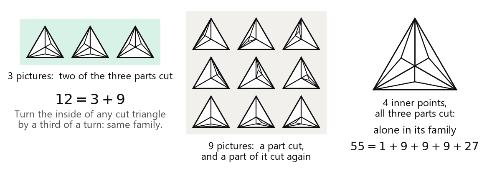

Put a point inside a triangle and join it to the corners; repeat inside any of the small triangles. The result is a ternary tree drawn as a picture (these are the stacked triangulations, or Apollonian networks, which physicists use as model networks [28]).

**Exact (E013, `c12_subdivisions.py`, by a geometric model with no trees in it).** Turn the inside of any cut triangle by a third of a turn. Families of pictures have 3^d members. With three inner points: 12 = 3 + 9. With four: 55 = 1 + 9 + 9 + 9 + 27, and the picture that stands alone is the one where all three parts are cut, the twin of tert-butyl.

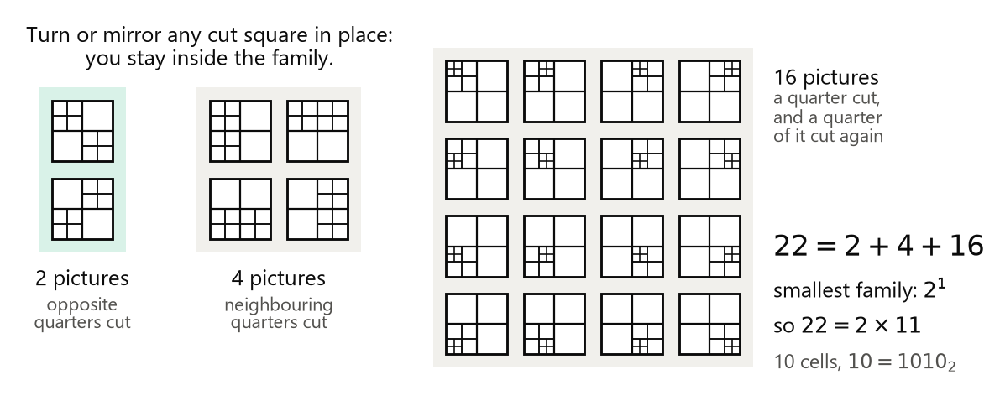

For prime powers there is a picture too. A quadtree cuts a square into four quarters and cuts some of those again; it is a standard way to store images and maps [24]. This is the case q = 4.

**Exact (E013, same script; my own check in the figure script).** The eight symmetries of a square permute its four quarters, and they keep the two diagonals together. That is exactly the group our proof puts at a node with four branches (next picture): it has order 8, a power of 2, although there are 24 permutations of four things. So: *turn or mirror any cut square in place*. Families of pictures have 2^d members. With three cuts, 22 = 2 + 4 + 16; the smallest family has 2, and 22 = 2 × 11. The number of families (1, 1, 1, 3, 6, 17, 44, …) agrees with OEIS A398109 for its first 15 terms [25]. For cubes cut into eight the count still obeys the theorem, but the symmetries of a cube are too few to give the picture.

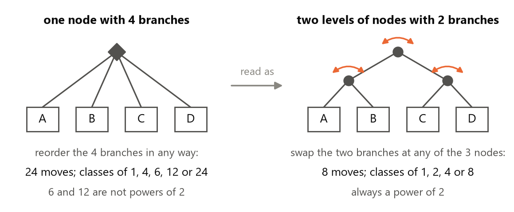

**Why prime powers work: bits, not bytes.** Konvalinka's proof lets all q branches of a node be permuted. That group is too big: its classes have sizes like 6 and 12. Our change is to read a node with q = p^k branches as k levels of nodes with p branches, and to rotate only at those (**exact**, E012 part B: 24 moves against 8, class sizes 1, 4, 6, 12, 24 against 1, 2, 4, 8). It is the difference between permuting the 256 values of a byte and flipping its 8 bits one at a time.

## 7. Physics: the lowest level decides

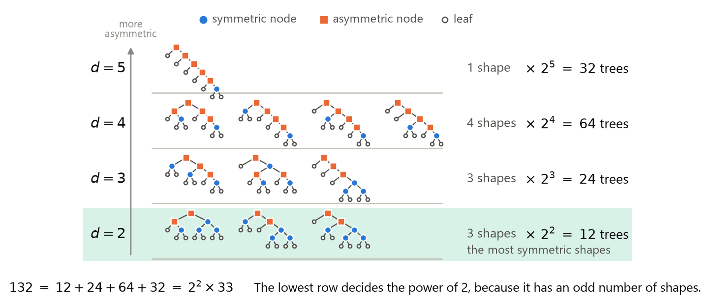

The 132 binary trees with 7 leaves, sorted into their 11 shapes. A shape with d asymmetric nodes carries 2^d trees.

**Exact.** 132 = 3·4 + 3·8 + 4·16 + 1·32. The power of 2 in 132 is 2, because the lowest row contributes 3·4 with 3 odd, and every other row is divisible by 8.

**Analogy.** Read d as an energy: the number of broken symmetries. With ordinary eyes the heaviest rows dominate the sum: most trees are lopsided. With 2-adic eyes it is the other way round, because 2^d is 2-adically *small* when d is large. So:

> **the power of p is the ground-state energy; the residue counts the ground states modulo p.**

That is the three parts of the proof: a lower bound for the energy, a description of the ground states, a count of them modulo p. It is also why the algebraic proof works: it is a first-order expansion in a variable y that stands for p, and p is p-adically small.

**Exact for p = 2, and literal in quantum field theory (E013, `c3_feynman.py`).** The eleven shapes are the tree-level Feynman diagrams, with seven sources, of a field with a cubic interaction (the classical field solves φ = J + (g/2)φ²; the setting is that of a 2001 paper on zero-dimensional field theory [26]). A diagram is divided by its symmetry factor, and that factor is 2^(number of symmetric vertices). So the coefficient is

    3/16 + 3/8 + 4/4 + 1/2 = 33/16 = Catalan(6)/2^6 .

The largest symmetry factor, 16, is the largest power of 2 dividing 7!, and an odd number of diagrams (three) have it; so 16 is exactly the denominator. In general: **the 2-adic size of the tree-level amplitude is set by its most symmetric diagrams**, and the largest symmetry factor at order m is the 2-part of m!. (For p ≥ 3 this is not literal: a physical vertex is symmetric under all permutations of its legs.)

The same picture in the language of statistical physics:

| In the proof | In physics |
|---|---|
| an ordered tree | a microstate |
| a shape (mobile) | a macrostate |
| p^d trees over a shape | its multiplicity; d·ln p is an entropy |
| number of asymmetric nodes d | energy, for a p-adic observer |
| complete tree with p^j leaves ("atom") | a particle of mass p^j |
| digit a_j ≤ p − 1 | occupation number: at most p − 1 equal particles may coexist |
| a carry | p equal particles fuse into one of the next size |
| division by ∏ a_j! in the residue | identical particles are not told apart (the Gibbs factor) |
| the sign (−1)^t | one factor −1 for each fusion still to be made |

The left column is exact; the right column is a dictionary, not a model of a physical system. (Statistics with a largest allowed occupation number were proposed by Gentile in 1940 [34]; the factor 1/N! for identical particles is standard [34].)

## 8. Light: doubling and mixing

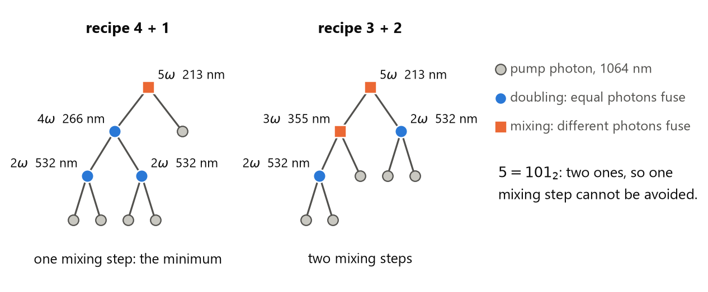

A nonlinear crystal can fuse two photons into one with the sum of their energies. Laser engineers chain such stages to turn infrared light into green and ultraviolet. The history of one photon of the m-th harmonic is a binary tree with m leaves: **doubling** (two equal photons) is a symmetric node, **mixing** (two different photons) an asymmetric one.

**Exact (E013, `c4_harmonics.py`, all shapes up to m = 20).** In the history of any photon of the m-th harmonic, at least popcount(m) − 1 of the fusions are mixings, whether "different" means different histories or different frequencies; and the histories with exactly that many are the trees of section 4.

Against practice (1064 nm pump): the third harmonic is made as 2 + 1 (one mixing, bound 1); the fourth as 2 + 2 (none, bound 0); for the fifth harmonic at 213 nm both recipes occur in the sources: 4 + 1, the minimum [27], and 3 + 2, which has two mixings (a trade article, source in the blind-hunt note).

**Analogy, with a caveat.** A real apparatus is not a tree, because a beam can be split and used twice. Counting crystals instead of fusions, the bound first fails at m = 15. Engineers choose recipes by efficiency, not by this count.

## 9. Computing: a carry is two equal blocks fusing

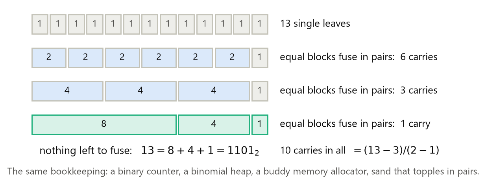

Take 13 single leaves and let equal blocks fuse in pairs until nothing can fuse. What is left is 8 + 4 + 1, the binary expansion of 13, and 10 fusions were made. Each fusion is a carry.

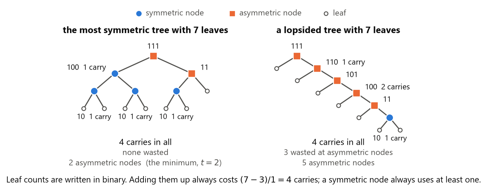

**Exact (claim C19, refereed).** Add up the leaves of a *tree*, node by node, in base p. Whatever the shape of the tree, the number of carries is the same: (m − digit sum)/(p − 1). A symmetric node adds p equal numbers, and that always carries. So the carries limit how many nodes can be symmetric, and at least t nodes are left over. The trees that waste no carry are the most symmetric ones.

The same bookkeeping, in working clothes (**exact** counting statements in E012, parts H–K, and E013; what each system is in its own field is in the source file, items 5 and 16–19):

- a **binary counter**: counting to m makes (m − number of ones) carries; the number of ones is the "potential" of its textbook analysis;
- a **binomial heap** keeps one tree for each binary digit 1 of the number of items; linking two equal trees is a carry [9];
- a **buddy memory allocator** splits a block into two equal "buddies" and merges two free buddies back into one [22];
- a **tamper-evident log**: the Merkle tree that the Certificate Transparency standard prescribes for n entries splits at the largest power of two below n [17]. That tree is one of our most symmetric trees: popcount(n) − 1 asymmetric nodes, the minimum, and its perfect subtrees are the binary digits of n. The picture in section 4 *is* the log tree for 13 entries. In the "mountain range" variant the perfect subtrees are kept as separate peaks; appending an entry merges equal peaks, and after n entries exactly n − popcount(n) merges have been made;
- a **Fenwick tree** answers "sum of the first n items" by adding one stored block for each binary digit 1 of n [21];
- **powers and products**: the binary method computes x^n with popcount(n) − 1 multiplications besides the squarings [23]. The Egyptian scribes multiplied the same way: 41 × 59 by doubling 59 five times and adding the rows for 1, 8 and 32; 41 = 101001 has three ones, so two additions [37]. Our lower bound says: however x·x·…·x (n factors) is bracketed, at least popcount(n) − 1 products multiply two differently shaped brackets. (With reuse of intermediate results fewer can suffice, first at n = 15.)

What the theorem adds to these familiar facts: the binary-digit construction is *optimal among all binary trees*, and the number of optimal shapes is odd, which is exactly why the Catalan number has the power of 2 it has.

## 10. Tree = cut of an interval = cut into balls

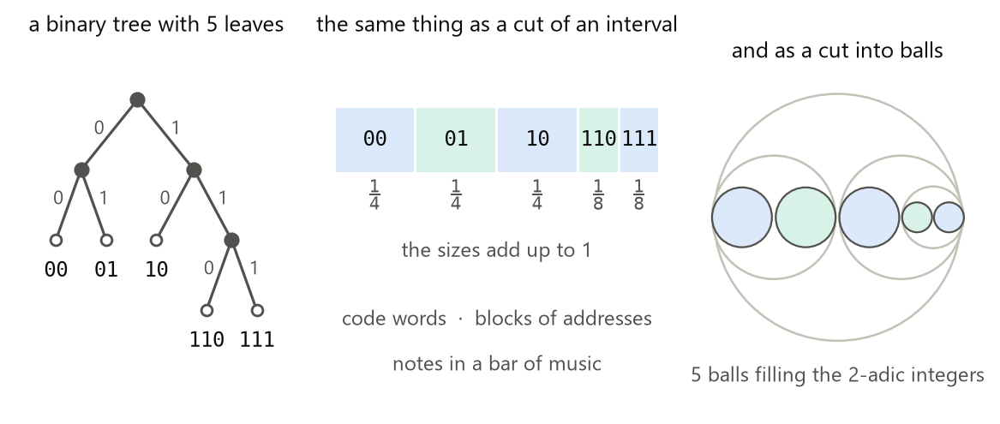

**Exact.** A binary tree with m leaves is the same thing as: a complete prefix code with m code words; a cut of the unit interval into m pieces by repeated halving; a cut of the 2-adic integers into m balls. The sizes of the pieces add up to 1. So the Catalan number C_(m−1) counts the ways to cut the 2-adic integers into m balls, and the theorem is about the 2-adic size of that number. For p-ary trees replace 2 by p everywhere.

**In other fields (analogy, exact counting underneath):**

- *Internet addresses.* A block of addresses is the set of addresses with a given prefix, and a block of prefix length n consists of two blocks of length n + 1 [33]. Cutting the address space into m blocks is a binary tree with m leaves of depth at most 32. **Exact (E012, part C, for depth up to 7; divisibility for every depth follows from the proof because rotations do not change the depth):** the number of such cuts is divisible by 2^(s − 1), where s is the number of ones of m. The old "classful" networks, with prefixes of 8, 16 or 24 bits, are the case q = 256. **Exact (E012, part D):** the number of 256-ary trees with n nodes has power of 2 equal to (number of ones of 255n + 1) − 1.
- *Text encoding.* In UTF-8 the first byte tells the length of a character and character boundaries can be found from anywhere [33]; so no character's code is the beginning of another's, a prefix code made of whole bytes (the deduction is ours).
- *Music.* Rhythms obtained by repeatedly dividing a duration are stored as trees in composition software (source file, item 8). A rhythm made by repeated halving of a bar is a binary tree; the number of such rhythms with m notes is a Catalan number, odd exactly when m is a power of 2, which is when the perfectly even rhythm exists. Triplets are p = 3.
- *Physics.* Nested balls of this kind are the blocks of hierarchical models; a 1989 paper connects such models with field theories on the p-adic numbers [16].

## 11. Prime powers as sand on a ring

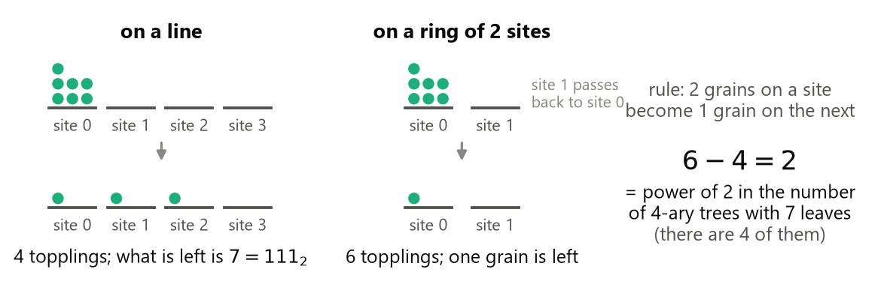

**Exact (stated and proved in `paper/accounting_proof.pdf`; this instance asserted in the figure script).** With the rule "p grains on a site become one grain on the next site", the power of p in the number of q-ary trees, q = p^k, is the number of topplings on a ring of k sites minus the number on a line, starting from m grains. For q = 4 and 7 leaves: 6 − 4 = 2, and there are 4 such trees.

## 12. Biology: evolution's own probability law, and cell lineages

**Exact, and stated in the literature (E012, part M; Steel 2025 [20], going back to Harding 1971).** In the simplest model of evolution, in which every lineage splits at the same rate (the Yule model), the probability of a tree shape T with n leaves is

    P(T) = 2^d(T) / ∏ over nodes v of (n_v − 1),

where n_v is the number of leaves below v and d(T) is our number of asymmetric nodes (the source writes 2^(n−1−s) with s the number of symmetry vertices). So the class size 2^d of the proof is the factor by which this model favours lopsided shapes. The two normalisations sit side by side: Σ 2^d = Catalan number, Σ 2^d/∏(n_v − 1) = 1.

**Exact core, analogy in the reading (E013, `c7_lineages.py`).** The cell lineage of an organism is the binary tree of its cell divisions. A lineage in which every division has two equivalent halves exists only when the number of final cells is a power of two; otherwise at least popcount(m) − 1 divisions are lopsided. Colonial green algae of the Volvox family have cell numbers that are powers of two, and the adult nematode C. elegans has 959 somatic nuclei, 959 = 1110111111 in binary, so at least 8 lopsided divisions [35]. The bound is weak for real animals; its interest is that it is sharp and that it vanishes only at powers of two. (Biologists call a division asymmetric when the daughters' fates differ, which is a finer notion than ours.)

## 13. An older name: Etherington's mutability (1939)

Checked on 2026-11-14: Syoma obtained the paper and the orchestrator read it [36]. For binary trees, Etherington calls a node *balanced* when its two branches have the same shape, and calls the number of unbalanced nodes the **mutability** of the shape. That is our d for p = 2. He observes that a shape of mutability μ has 2^μ ordered versions (our class size), writes down the generating function f(x, y) with y marking mutability and its equation f = x + ½·y·f² + (1 − ½·y)·f(x², y²), notes that y = 2 gives the Catalan numbers and y = 1 the commutative count, and proves that the number of leaves is a sum of μ + 1 powers of two. His polynomials y + y² + y³ and y + 2y² + 2y³ + y⁴ for 5 and 6 leaves are the ones in our tables.

He draws a product as a "pedigree" with "generations": the vocabulary is that of heredity.

What he does not do: ask which power of 2 divides the Catalan numbers, describe or count the most symmetric shapes, or go beyond two branches. So for p = 2 the mobile picture, the class size and the two-variable series are his (1939), and the exact power of 2 by this route is Deutsch and Sagan (2006). Ours, as far as we know: every prime, prime powers, and the count modulo p. **He must be cited**, in the papers and on the reference slide. A human should confirm this reading.

## 14. The first three minutes of the talk, as a script

1. *(pattern)* "Count the binary trees with n nodes: 1, 2, 5, 14, 42, 132, 429. Which of these are odd? Exactly those where n + 1 is a power of two. And the power of 2 in the others is the number of ones in n + 1, minus one. The same happens for every prime."
2. *(mobile)* "Hang a tree up as a mobile. Each bar can spin. A drawing of the tree is a photograph of the mobile, and a mobile with d lopsided bars has 2 to the d photographs. So the number of drawings is a sum of powers of two, one for each mobile."
3. *(one tree, four sciences)* "Trees like these are everywhere: evolution, tournaments, codes, music. In none of them does left and right mean anything."
4. *(butyl groups)* "With three branches it is chemistry. These are the five butyl groups. Over them stand 1, 9, 9, 9 and 27 trees: 55, not divisible by 3, for a reason you can see: tert-butyl is perfectly symmetric, so it stands alone."
5. "So the power of p measures the best symmetry a tree with m leaves can have. The known proof computes it with factorials. We will read it off the trees: the most symmetric tree is built from the digits of m."

## 15. What is exact and what is not

| Item | Kind | Evidence |
|---|---|---|
| class size p^d; sum over shapes; "mobiles" | exact | main proof; E000, E003; OEIS A398107 for the name |
| the description of the most symmetric trees by digits | exact | main proof; carry-budget note (refereed) |
| 55 = 1 + 9 + 9 + 9 + 27 and the five classes | exact (the tree statement); the chemical names are standard, the two forms of sec-butyl only weakly sourced | E012 A; [30] |
| "tert-butyl has 81 rotations" | exact in the tree model; a real molecule has other motions too | E012 A |
| Stockmayer's factor = Fuss–Catalan number / number of free groups | exact arithmetic; the formula's role in polymer theory from a secondary source | E012 L; [18], [19] |
| triangles: 12 = 3 + 9; squares: 22 = 2 + 4 + 16; the square's symmetries are our group | exact | E013 `c12_subdivisions.py`; figure script |
| energy levels, ground state, the dictionary | analogy; the arithmetic is exact | E012 G, E010 |
| Feynman diagrams of a cubic theory: symmetry factor 2^σ, denominator = largest symmetry factor | exact for p = 2; the physical setting from [26]; the sentence about symmetry factors is ours | E013 `c3_feynman.py` |
| laser harmonics: at least popcount(m) − 1 mixings in a photon's history | exact core; real apparatus reuse beams | E013 `c4_harmonics.py`; [27] |
| counter, heap, allocator, sand | analogy; the carry counts are exact | E011 B, F; E012 F |
| the log Merkle tree is a most symmetric tree | exact; the definition is in the standard | E012 H; [17] |
| mountain ranges, Fenwick blocks, binary powers, Egyptian multiplication | exact counting; descriptions from documentation and handbooks | E012 I, J, K; E013; [21], [23], [37] |
| bits and bytes; class sizes for q = 4; 256-ary trees | exact | E012 B, D |
| cuts into balls, codes, address blocks, rhythms | exact as counting statements | E012 C; direct bijection |
| divisibility for bounded depth | exact (consequence of the proof); exactness of the power only computed up to depth 7 | E012 C |
| Yule probability 2^d/∏(n_v − 1) | exact, and in the literature | E012 M; [20] |
| cell lineages | exact for tree shapes; the biological notion of asymmetric division is finer | E013 `c7_lineages.py`; [35] |
| Etherington's "mutability" is our d for p = 2; his equation (33) is our deformed equation for p = 2 | confirmed by reading the paper (AI); a human should confirm | [36] |
