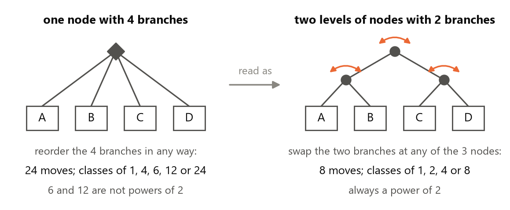
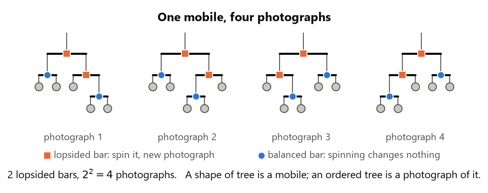
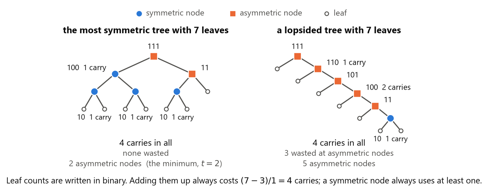
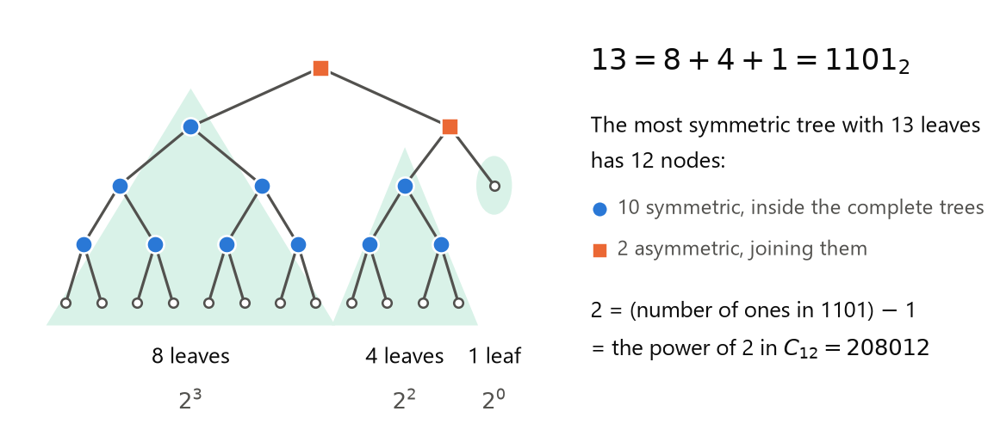
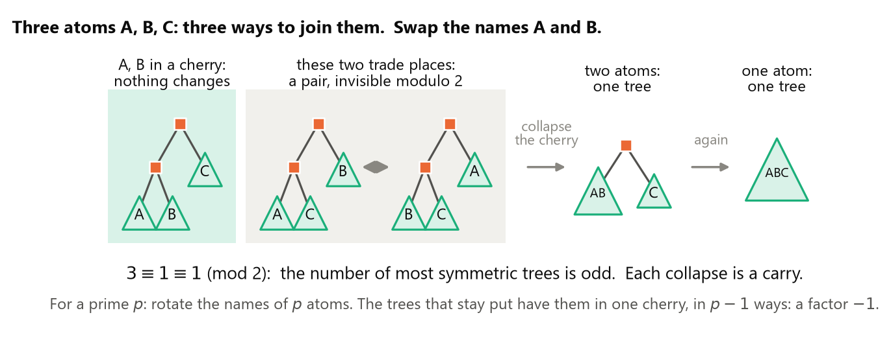
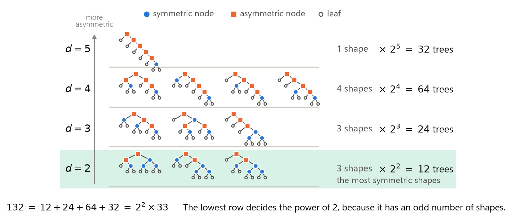

# The main proof on one page, in pictures

- **Date:** 2026-11-14 (Saturday, about 12:30 PT). **Author:** Claude Fable 5.2 (AI, orchestrator).
- **For:** Syoma and the grad student, to follow next to `paper/main.pdf`. It adds nothing new; it says where each step is and what to look at. Longer versions: `notes/study_guide.md` (exercises), `notes/briefing_grad_student/briefing_for_grad_student.pdf`.
- **One example all the way through:** p = 2, binary trees with **7 leaves** (6 nodes). There are 132 of them, and 132 = 4 × 33. We want to *see* the 4.

**The theorem.** The number of trees with m leaves is divisible by p exactly t times, where t = (digit sum of m in base p − 1)/(p − 1). Here 7 = 111 in binary, digit sum 3, t = 2.

---

## Step 0 — only if q is a prime power: read a node with q branches as k levels of nodes with p branches

*Paper:* Lemma "Blocked form". *Why:* so that the only moves we ever make are rotations of p branches. *Example:* not needed (q = p = 2).

## Step 1 — a shape is a mobile, and it has p^d photographs

Two trees are *equivalent* if you can turn one into the other by rotating the branches at some nodes. A node is *symmetric* if its branches are equivalent to each other, *asymmetric* (lopsided) otherwise; d = number of asymmetric nodes.

**Claim.** An equivalence class has exactly p^d trees.

*Paper:* Lemma "Normal form", Lemma "Class size". *Why p must be prime:* p rotations of a necklace of p beads are either all the same or all different. *Example:* the 132 trees fall into 11 shapes with 4, 4, 4, 8, 8, 8, 16, 16, 16, 16, 32 trees.

## Step 2 — every tree has at least t lopsided nodes

Add up the leaves in base p. Every tree makes the same number of carries. A symmetric node always makes one. So only so many nodes can be symmetric.

*Paper:* "Digit lemma", Proposition "Lower bound" (there by induction; the carry version is `notes/2026-11-14_carry_budget.md`). *Example:* 4 carries, 6 nodes, so at least 2 lopsided nodes: every shape has at least 2² = 4 trees. So 4 divides 132. **This much is also Konvalinka's result; the rest is the new part.**

## Step 3 — the shapes with exactly t lopsided nodes are built from the digits of m

No carry may be wasted. That forces: complete trees ("atoms"), one for each unit of each digit of m, joined by t lopsided nodes.

*Paper:* Proposition "Local characterization", Definition of skeleton trees, Proposition "Minimal classes are skeleton trees". *Example:* 7 = 4 + 2 + 1: atoms with 4, 2 and 1 leaves, joined by 2 nodes. There are 3 ways: which atom hangs alone at the top.

## Step 4 — count them modulo p: a carry is a collapsing cherry

Give the atoms names. Rotate the names of p of them. Trees come in groups of p, except those where the p atoms sit together in a cherry; there are p − 1 such arrangements. Collapse the cherry into one atom and repeat. Each collapse multiplies the count by p − 1 ≡ −1, and there are t of them.

*Paper:* Proposition "Removing labelling" (equal atoms may be told apart at the price of dividing by ∏ m_j!), "Moving-leaf lemma", Proposition "A carry collapses a cherry", Lemma "Terminal vectors", Proposition "Iterated carries". *Example:* 3 → 1 → 1, so the number of most symmetric shapes, 3, is odd.

## Conclusion — the smallest classes decide

132 = 3·4 + (3·8 + 4·16 + 32). The bracket is divisible by 8; the first term is 4 times an odd number. So 132 is divisible by 4 and not by 8. In general: valuation = t, and (count)/p^t ≡ (−1)^t / ∏ m_j! modulo p.

---

## The three places to read slowly

These are where the reviewers found most to repair, so they deserve a human eye:

1. **Lemma "Plane representatives".** It says that a mobile with named leaves has exactly p^(number of nodes) drawings, and that the classes of drawings are the mobiles. Everything in Step 4 leans on it.
2. **The converse half of "Minimal classes are skeleton trees".** Going from a minimal tree to its skeleton is easy; that *every* skeleton with the right atoms gives a minimal tree, and that the two constructions undo each other, is the delicate direction.
3. **Proposition "Removing labelling".** Why naming equal atoms multiplies the count by exactly ∏ m_j! (no named arrangement is fixed by a non-trivial renaming).

## Six questions to test yourselves

1. Why is a class size a power of p, and where is "p prime" used?
2. Compute d for the two shapes of binary trees with 4 leaves. (0 and 2.)
3. Why does a symmetric node always carry?
4. For 6 leaves, why can a most symmetric tree not split 3 + 3 at the root? (In binary 11 + 11 carries twice; a symmetric root would need 3 to be a power of 2, and a lopsided root may not carry at all. The only split that works is 4 + 2.)
5. In Step 4, why do the trees that "stay put" have the p named atoms in one cherry?
6. Where does the sign (−1)^t come from? (From p − 1 ≡ −1, once per collapse; equivalently Wilson's theorem.)

Answers are in `notes/study_guide.md` and `talk/QA.md`.
