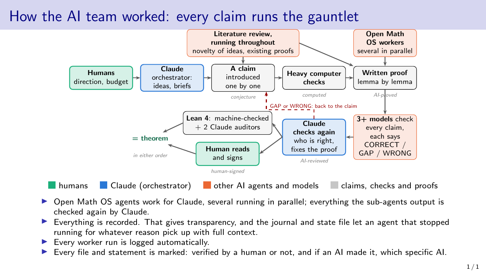

<!-- Text version of ai_workflow_slide.pdf / .png. Written by Claude Opus 5.5 (Claude Code), 2026-11-15. -->

# How the AI team worked: every claim runs the gauntlet

## The flow

1. **Humans** set the direction and the budget.
2. **Claude (orchestrator)** has the ideas and writes the briefs.
3. **A claim** is introduced, one at a time. *(grade: conjecture)*
   - A **literature review, running throughout**, checks the novelty of ideas and looks for existing proofs.
4. **Heavy computer checks** on every small case. *(grade: computed)*
5. **Written proof**, lemma by lemma. *(grade: AI-proved)*
   - **Open Math OS workers**, several running in parallel, draft LaTeX and Lean.
6. **3+ models check every claim**; each says **CORRECT**, **GAP** or **WRONG**.
7. **Claude checks again**: decides who is right and fixes the proof. *(grade: AI-reviewed)*
   - GAP or WRONG sends the claim back to the start.
8. Then, in either order:
   - **Lean 4**: machine-checked, plus 2 Claude auditors who check the statements say what we claim.
   - **A human reads and signs.** *(grade: human-signed)*
9. **= theorem**

## Colour key

- Green: humans
- Blue: Claude (orchestrator)
- Orange: other AI agents and models
- Grey: claims, checks and proofs

## Nothing lost, everything traceable

- Open Math OS agents work for Claude, several running in parallel; everything the sub-agents output is checked again by Claude.
- Everything is recorded. That gives transparency, and the journal and state file let an agent that stopped running for whatever reason pick up with full context.
- Every worker run is logged automatically.
- Every file and statement is marked: verified by a human or not, and if an AI made it, which specific AI.

---

# What we achieved: four proofs of Problem 137

(Slide 2 of ai_workflow_slide.pdf. Added by Claude Opus 5.5 (Claude Code), 2026-11-15.)

| Proof | Lean verified | Human checked |
|---|---|---|
| Lattice paths | ✓ | read, no gaps found |
| Algebraic (Frobenius) | ✓ | not verified |
| Accounting | ✓ | read, no gaps found |
| Main: symmetries of trees | ✓ | rigorously verified |

Lean verified: builds on Lean v4.35.0 / Mathlib, no `sorry`, standard axioms only.
