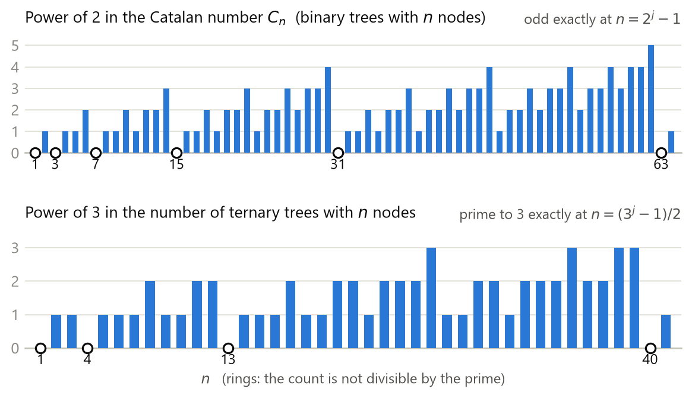
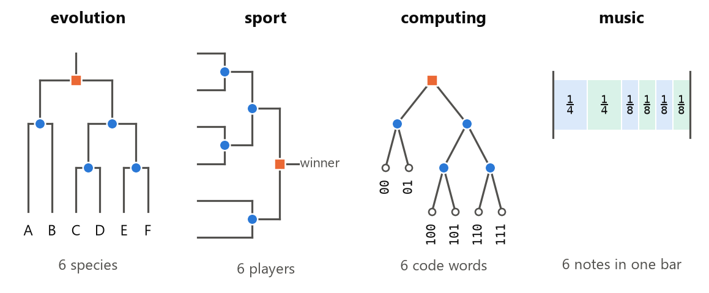
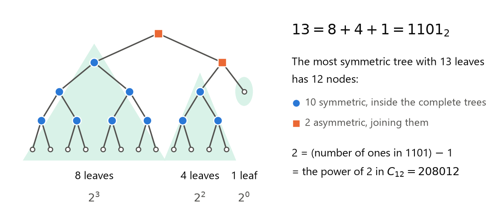
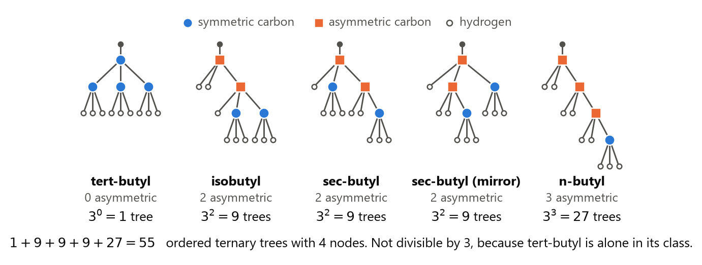
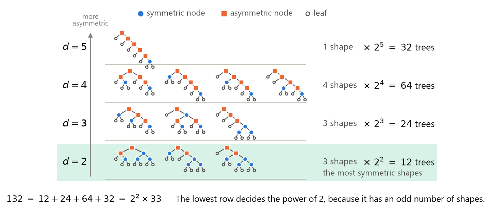
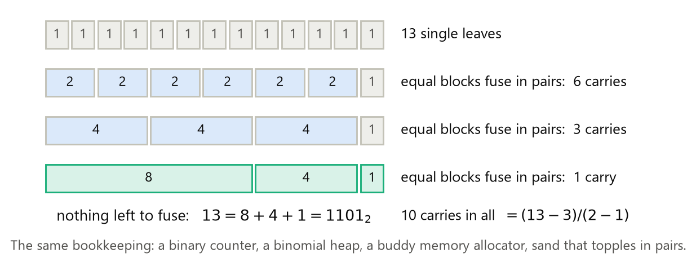
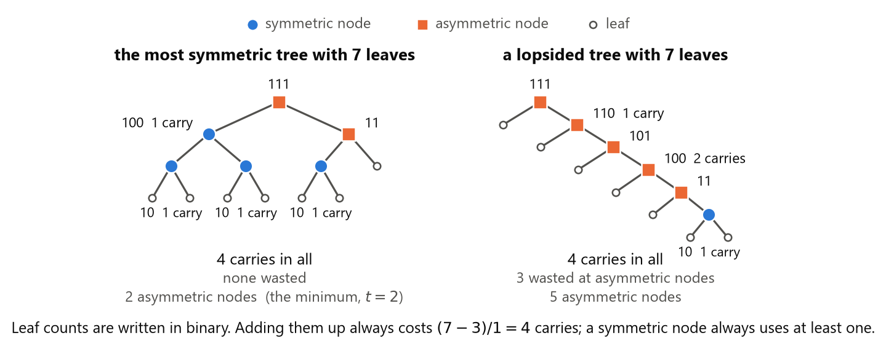
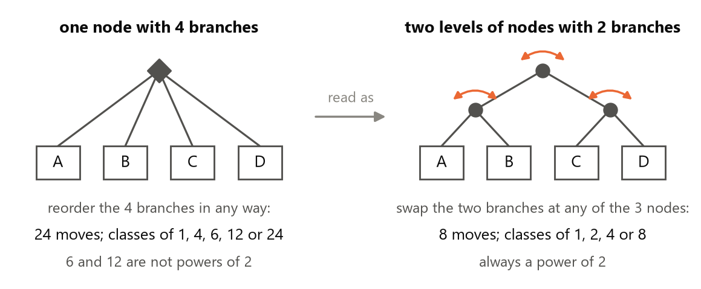
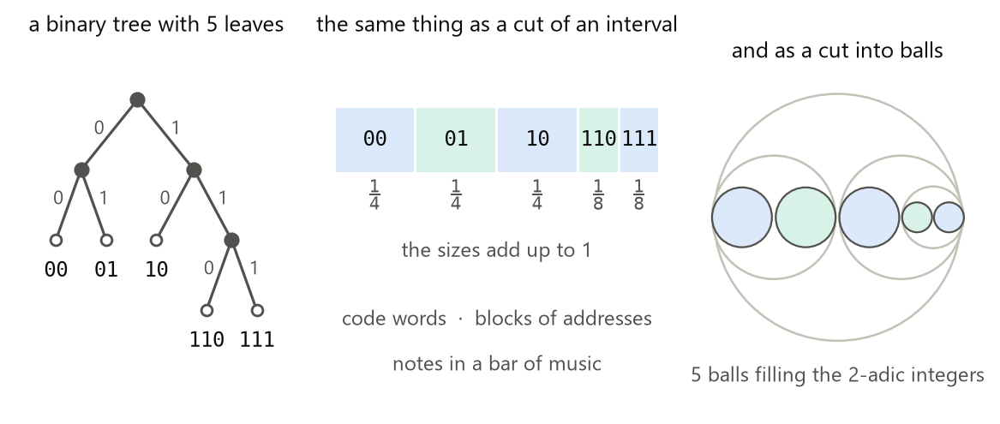
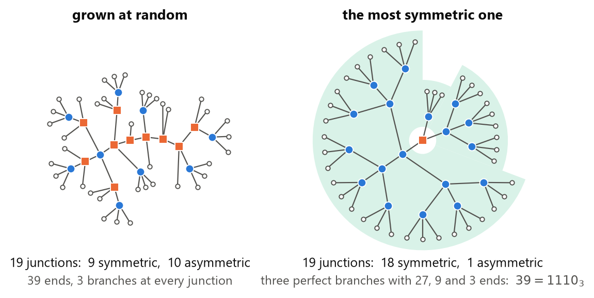

# Why this problem, and where its trees live

- **Date:** 2026-11-14 (Saturday, late morning)
- **Author:** Claude Fable 5.2 (AI, orchestrator), at the team's request for motivation, physical connections and pictures.
- **Status:** every statement marked **exact** is a consequence of the main proof (approved by the professor on 2026-11-14, name pending in `CLAIMS.md`) or is checked by computer in `experiments/E011_crossfield_checks` and `experiments/E012_connections`. Statements marked **analogy** are ways of speaking. Statements about other fields rest on the sources in `references/README.md` (entries 6–16) and in `notes/2026-11-14_crossfield_literature.md`; a second source check (`notes/2026-11-14_motivation_sources.md`) was still running when this was written. Not human-verified.
- **Pictures:** all figures are produced by `talk/figures/make_figures.py` (PDF for the slides, PNG here). Blue circle = symmetric node, orange square = asymmetric node, green = a complete tree.

---

## 1. The pattern

The Catalan number C_n counts binary trees with n nodes. It is odd exactly when n + 1 is a power of 2, and in general the power of 2 in it is (number of ones in the binary expansion of n + 1) − 1. In a computer that is one instruction: popcount(n + 1) − 1. The same happens for every prime p and trees with p branches: the power of p is (digit sum of the number of leaves − 1)/(p − 1).

This has been known for a long time, by a computation with factorials. The computation gives the answer and no reason. **The question of Problem 137 is the reason: why should the digits of a number have anything to do with trees?**

## 2. One tree, four sciences

The same tree with 6 leaves, as an evolutionary tree, a knockout tournament, a prefix code and a bar of music. In each of these the left-to-right order of the branches is an accident of the drawing: swapping the two branches at a node changes nothing that matters. So each field really works with **shapes**, and the natural question is the same everywhere:

> **How many ordered trees stand over one shape?**

**Exact.** Always a power of 2: 2^d, where d is the number of nodes whose two branches have different shapes (orange). So the Catalan number is a sum of powers of 2, one for each shape, and the smallest power that occurs is its power of 2, provided the number of shapes with that smallest power is odd. That is the whole plan of the proof.

In the picture, 6 = 110 in binary has two ones, so every tree with 6 leaves has at least 2 − 1 = 1 lopsided node, and the tree shown has exactly one. Biologists count these nodes to measure how balanced an evolutionary tree is (Kersting and Fischer 2021, reference 4).

## 3. What the theorem says: the best possible symmetry

**Exact.** A tree with m leaves has (m − 1)/(p − 1) nodes. The theorem says that at least t of them are asymmetric, t = (digit sum of m − 1)/(p − 1), and that the trees with exactly t are these: write m in base p; take one complete tree for every unit of every digit; join them by t asymmetric nodes. The digits of m are not a formula in this proof. **They are the building blocks of the most symmetric tree.**

Equivalently (**exact**): the symmetries of a tree form a group of order p^(number of symmetric nodes), and

    power of p in the number of trees = (number of nodes) − log_p(order of the largest symmetry group).

The trees that reach it are exactly those whose symmetry group is as large as a group of p-power order acting on m leaves can be (a Sylow p-subgroup of the symmetric group on the leaves).

## 4. Chemistry: the five butyl groups

The three further bonds of a carbon atom can be rotated but not reflected. So an alkyl group is a ternary tree up to rotation at every node, and the classes of our proof for p = 3 are the alkyl groups, with mirror images counted separately (OEIS A000625: 1, 1, 2, 5, 11, 28, 74, …).

**Exact (E012, part A).** For four carbons there are five: tert-butyl, isobutyl, sec-butyl in its two mirror-image forms, and n-butyl. Over them stand 1, 9, 9, 9 and 27 ordered ternary trees: 55 in all. The number 55 is not divisible by 3 **because tert-butyl is alone in its class**: it is perfectly branched, and all 81 = 3^4 rotations of its four carbons leave it unchanged. If reflections are allowed as well, the two sec-butyls merge and four groups remain, the four butyl groups of every chemistry textbook (OEIS A000598).

**Exact.** The number of ternary trees with n nodes is prime to 3 exactly when n = 1, 4, 13, 40, …, the sizes at which a perfectly branched group exists (methyl, tert-butyl, …). In general the power of 3 measures how far the most symmetric group with n carbons is from perfect branching.

**Analogy with a real counterpart.** Chemists call the order of such a group the symmetry number σ. It lowers the entropy of a molecule by R·ln σ, and a freely rotating methyl group contributes a factor 3 (Gilson and Irikura 2010, reference 11). Perfectly branched molecules of this kind are made on purpose: dendrimers, built from a core and perfect branches called dendrons (source check pending). Our minimal trees have that architecture: a small irregular core carrying perfect dendrons, one for each digit.

## 5. Physics: the lowest level decides

The 132 binary trees with 7 leaves, sorted into their 11 shapes. A shape with d asymmetric nodes carries 2^d trees.

**Exact.** 132 = 3·4 + 3·8 + 4·16 + 1·32. The power of 2 in 132 is 2, because the lowest row contributes 3·4 with 3 odd, and every other row is divisible by 8.

**Analogy.** Read d as an energy: the number of broken symmetries. A shape is a state, 2^d its weight. With ordinary eyes the heaviest rows dominate the sum: most trees are lopsided. With 2-adic eyes it is the other way round, because 2^d is 2-adically *small* when d is large. So the 2-adic size of the Catalan number is decided by the ground states alone:

> **the power of p is the ground-state energy; the residue counts the ground states modulo p.**

That is exactly the three parts of the proof: a lower bound for the energy, a description of the ground states, and a count of them modulo p. It is also why the second, algebraic proof works: it is a first-order expansion in a variable y that stands for p, and p is p-adically small.

The same picture in the language of statistical physics:

| In the proof | In physics |
|---|---|
| an ordered tree | a microstate |
| a shape (rotation class) | a macrostate |
| p^d trees over a shape | its multiplicity; d·ln p is an entropy |
| number of asymmetric nodes d | energy, for a p-adic observer |
| complete tree with p^j leaves ("atom") | a particle of mass p^j |
| digit a_j ≤ p − 1 | occupation number: at most p − 1 equal particles may coexist |
| a carry | p equal particles fuse into one of the next size |
| division by ∏ a_j! in the residue | identical particles are indistinguishable (Gibbs factor) |
| the sign (−1)^t | one factor −1 for each fusion still to be made |

The left column is exact; the right column is a dictionary, not a model of any physical system.

## 6. Computing: a carry is two equal blocks fusing

Take 13 single leaves and let equal blocks fuse in pairs until nothing can fuse. What is left is 8 + 4 + 1, the binary expansion of 13, and 10 fusions were made. Each fusion is a carry.

**Exact (claim C19, refereed).** Now add up the leaves of a *tree*, node by node, in base p. Whatever the shape of the tree, the number of carries is the same: (m − digit sum)/(p − 1). A symmetric node adds p equal numbers, and that always carries. So the carries limit how many nodes can be symmetric, and at least t nodes are left over. The trees that waste no carry are the most symmetric ones.

This is how several things in a computer work (**analogy**, with exact arithmetic underneath):

- a **binary counter**: counting to m makes (m − number of ones) carries; the number of ones is the "potential" of its textbook analysis;
- a **binomial heap**: it keeps one tree for each binary digit 1 of the number of items, and linking two equal trees is a carry (Vuillemin 1978, reference 9);
- a **buddy memory allocator**: two free blocks of equal size merge into one of twice the size (source check pending);
- **sand** that topples p grains into one grain on the next site.

In all of them the digits of m are what is left when nothing can merge any more. In our theorem, t is the number of merges that are still missing to make one tree out of what is left.

## 7. Why prime powers work: bits, not bytes

Konvalinka's proof lets all q branches of a node be permuted. That group is too big: its classes have sizes like 6 and 12, which are not powers of 2, so the sum cannot be read off. Our change is to read a node with q = p^k branches as k levels of nodes with p branches, and to rotate only at those.

**Exact (E012, part B).** For q = 4: 24 moves against 8, class sizes 1, 4, 6, 12, 24 against 1, 2, 4, 8.

**Analogy.** It is the difference between permuting the 256 values of a byte and flipping its 8 bits one at a time. A tree with 256 branches per node is a prefix code whose code words are whole bytes; read in bits, it is a binary tree whose leaves all sit at a depth divisible by 8. **Exact (E012, part D):** the number of such trees with n nodes has power of 2 equal to (number of ones of 255n + 1) − 1.

## 8. Tree = cut of an interval = cut into balls

**Exact.** A binary tree with m leaves is the same thing as: a complete prefix code with m code words; a cut of the unit interval into m pieces by repeated halving; a cut of the 2-adic integers into m balls. The sizes of the pieces add up to 1. So the Catalan number C_(m−1) counts the ways to cut the 2-adic integers into m balls, and the theorem is about the 2-adic size of that number. For p-ary trees replace 2 by p everywhere.

**In other fields (analogy, exact counting underneath):**

- *Internet addresses.* A block of addresses is the set of addresses with a given prefix, and a block splits into two blocks with one more bit of prefix. Cutting the address space into m blocks is a binary tree with m leaves of depth at most 32. **Exact (E012, part C, for depth up to 7; divisibility for every depth follows from the proof because rotations do not change the depth):** the number of such cuts is divisible by 2^(s − 1), where s is the number of ones of m. The old "classful" networks, with prefixes of 8, 16 or 24 bits, are the case q = 256.
- *Music.* A rhythm obtained by repeatedly halving a bar is a binary tree; the number of rhythms with m notes is a Catalan number, odd exactly when m is a power of 2, which is when the perfectly even rhythm exists. Triplets are p = 3.
- *Physics.* Nested balls of this kind are the blocks of hierarchical models; a 1989 paper connects such models with field theories on the p-adic numbers (reference 16, abstract only).

## 9. Polymers: perfect branching against random branching

Two tree-like molecules with 39 ends and three branches at every junction. Left: grown at random, 10 of its 19 junctions are asymmetric. Right: the most symmetric one possible, with a single asymmetric junction carrying three perfect branches of 27, 9 and 3 ends, because 39 = 1110 in base 3.

**Exact.** With m ends and p branches per junction, at least t junctions are asymmetric, and the molecules with exactly t are a core of t junctions carrying perfect branches, one for each unit of each base-p digit of m.

**Exact (E012, part L; brute force over all labelled trees for small sizes).** The number of ways to join n labelled units, each with f distinguishable reactive groups, into a tree-like molecule is f^n·(fn − n)!/(fn − 2n + 2)!. Divided by n! this is

    f^n · (Fuss–Catalan number for q = f − 1 and n) / ((f − 2)n + 2).

So, up to a simple factor, **Fuss–Catalan numbers are the statistical weights of n-mers in the theory of branched polymers**; units with three reactive groups give the Catalan numbers. (This counting is the starting point of the classical theory of gelation of Flory and Stockmayer; the attribution and the exact form in the literature are in the source check, item 20.)

**Analogy with a real counterpart.** Chemists make both kinds of molecule: hyperbranched polymers, which grow at random, and dendrimers, which are built step by step to be perfect. Our "atoms" are the perfect branches (dendrons). The theorem says how close to a dendrimer a molecule with a given number of ends can come: perfect exactly when m is a power of p, and otherwise t junctions short.

## 10. More computing: logs, running sums, powers

Each of these is the tree of section 3 in working clothes. (**Exact** statements checked in E012, parts H–K; the descriptions of the systems are in the source check, items 16–19.)

- **Tamper-evident logs.** The Merkle tree of a transparency log over n entries is defined by splitting at the largest power of two below n. That tree is one of our most symmetric trees: it has popcount(n) − 1 asymmetric nodes, the minimum, and its perfect subtrees are the binary digits of n. The picture in section 3 *is* the log tree for 13 entries. In the "mountain range" variant the perfect subtrees are kept as separate peaks, one per binary digit; appending an entry merges equal peaks, and after n entries exactly n − popcount(n) merges have been made: the carries of counting to n.
- **Running sums.** A Fenwick tree answers "sum of the first n items" by adding one stored block for each binary digit 1 of n: popcount(n) − 1 additions.
- **Powers.** Computing x^n as a product of repeated squares takes popcount(n) − 1 multiplications besides the squarings. A squaring is a symmetric node. Our lower bound says more: however x·x·…·x (n factors) is bracketed, at least popcount(n) − 1 products multiply two differently shaped brackets.

What the theorem adds to these familiar facts: the binary-digit construction is *optimal among all binary trees*, and the number of optimal shapes is odd, which is exactly why the Catalan number has the power of 2 it has.

## 11. Evolution's own probability law

**Exact (E012, part M).** In the simplest model of evolution (every lineage splits at the same rate; the Yule model), the probability of a tree shape T with n leaves is

    P(T) = 2^d(T) / ∏ over nodes v of (n_v − 1),

where n_v is the number of leaves below v and d(T) is our number of asymmetric nodes. So the class size 2^d of the proof is the factor by which this model favours lopsided shapes. The two normalisations sit side by side: Σ 2^d = Catalan number (all ordered trees), Σ 2^d/∏(n_v − 1) = 1 (all probability). (Where this formula is stated in the literature: source check, item 21.)

## 12. The first three minutes of the talk, as a script

1. *(pattern picture)* "Count the binary trees with n nodes: 1, 2, 5, 14, 42, 132, 429. Which of these are odd? Exactly those where n + 1 is a power of two. And the power of 2 in the others is the number of ones in n + 1, minus one. The same happens for every prime."
2. *(one tree, four sciences)* "Trees like these are everywhere: in evolution, in tournaments, in codes, in music. And in every one of these, the order of the branches means nothing. So the honest question is: how many ordered trees stand over one shape? The answer is always a power of two."
3. *(butyl groups)* "For p = 3 this is chemistry. These are the five butyl groups. Over them stand 1, 9, 9, 9 and 27 ternary trees. That is 55, and 55 is not divisible by 3 for a reason you can see: tert-butyl is perfectly symmetric, so it stands alone."
4. "So the power of p measures the best symmetry a tree with m leaves can have. The known proof computes it with factorials. We will read it off the trees: the most symmetric tree is built from the digits of m."

## 13. What is exact and what is not

| Item | Kind | Evidence |
|---|---|---|
| class size p^d; sum over shapes | exact | main proof; E000, E003 |
| the description of the most symmetric trees by digits | exact | main proof; carry-budget note (refereed) |
| 55 = 1 + 9 + 9 + 9 + 27, and the names of the five classes | exact (the tree statement); the chemical names are standard | E012 A |
| "tert-butyl has 81 rotations" | exact in the tree model; a real molecule has other motions too | E012 A |
| energy levels, ground state | analogy; the arithmetic is exact | E012 G, E010 |
| counter, heap, allocator, sand | analogy; the carry counts are exact | E011 B, F; E012 F |
| bits and bytes; class sizes for q = 4 | exact | E012 B, D |
| cuts into balls, codes, address blocks, rhythms | exact as counting statements | E012 C; direct bijection |
| divisibility for bounded depth | exact (consequence of the proof); exactness of the power only computed up to depth 7 | E012 C |
| the physics dictionary of section 5 | analogy | — |
| the count of tree-like n-mers and its relation to Fuss–Catalan numbers | exact as a counting statement; the link to polymer theory rests on the source check | E012 L |
| the log Merkle tree is a most symmetric tree; mountain-range merges are carries | exact for the tree defined in E012; that this is the tree used in practice rests on the source check | E012 H, I |
| Fenwick blocks; repeated squaring | exact | E012 J, K |
| P(T) = 2^d/∏(n_v − 1) | exact for the model as defined in E012; the name "Yule model" rests on the source check | E012 M |
